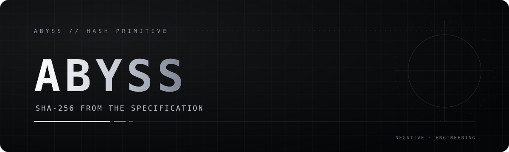

<div align="center">



# Abyss

**SHA-256 written from FIPS 180-4 in C++17, with no crypto dependencies.**

<p>
  
  
  
  
  
</p>

</div>

> Abyss (formerly `sha-zero`) is a compact SHA-256 library and CLI: a streaming
> `sifr::Sha256` class, an installable CMake package, and a `sifr-crypt` binary
> that hashes files or stdin.

## What it is

Abyss implements SHA-256 exactly as specified by FIPS 180-4: the padding,
message schedule, compression function and 32-byte digest, with no OpenSSL or
other crypto library. The reusable part is `sifr::Sha256` in
`include/sifr/sha256.h`; the `sifr-crypt` CLI feeds it from a file or stdin.

The repository is still `Sifr-Dev/sha-zero`, a name from the original plan to
cover SHA primitives and zero-knowledge work. **Only the SHA-256 half exists.**
There is no zero-knowledge protocol, proof system, or commitment scheme in this
tree, and the README does not claim one.

The binary, library target and CMake package also keep their original
`sifr-crypt` / `sifr::sha256` names so existing build scripts keep working.

## Current capabilities

- **SHA-256 per FIPS 180-4** — compression and padding in `src/sha256.cpp`,
  public API in `include/sifr/sha256.h`.
- **Streaming API** — `update()` accepts unaligned binary buffers; `finish()` and
  `hexdigest()` are const and repeatable, and updates may continue afterwards
  (`test_api_contract`, `tests/sha256_test.cpp`).
- **Correctness against the standard** — FIPS one-shot and streaming vectors,
  including one million `a` bytes, and every padding/buffer split boundary
  (`test_nist_vectors`, `test_binary_and_boundaries`).
- **Differential testing against Python `hashlib`** — 372 deterministic cases
  through both stdin and a real file (`tests/differential.py`).
- **CLI** — `sifr-crypt sha256 <file>`, `-` for stdin, stdin by default; only the
  lowercase digest is printed on success (`main.cpp`, `tests/cli_test.py`).
- **Explicit I/O failure handling** — open, read, close and `/dev/full` output
  failures return a diagnostic and a nonzero status (`tests/cli_test.py`).
- **Installable CMake package** — `sifr::sha256` export with config and version
  files (`CMakeLists.txt`, `tests/package-check.sh`).
- **Strict builds** — warnings are errors by default; an ASan + UBSan build is a
  supported configuration (`CMakeLists.txt`, `.github/workflows/ci.yml`).
- **No third-party dependencies** — only the C++ standard library and POSIX I/O.

## Quick start

```sh
git clone https://github.com/Sifr-Dev/sha-zero.git
cd sha-zero
cmake -S . -B build -DCMAKE_BUILD_TYPE=Release
cmake --build build --parallel
./build/sifr-crypt sha256 README.md
printf 'abc' | ./build/sifr-crypt sha256
```

```cpp
#include <sifr/sha256.h>

sifr::Sha256 hash;
hash.update(data, size);
std::string hex = hash.hexdigest();
```

## Verification

```sh
cmake -S . -B build -DCMAKE_BUILD_TYPE=Release
cmake --build build --parallel
ctest --test-dir build --output-on-failure
```

Observed on this machine (2026-11-28; GCC 16.2.1, CMake 4.5.0, Python 3.14.10,
AMD Ryzen 7 7435HS):

```text
1/3 Test #1: unit ......... Passed
2/3 Test #2: differential . Passed   (372 cases)
3/3 Test #3: cli .......... Passed
100% tests passed out of 3
```

Sanitizer configuration:

```sh
cmake -S . -B build-sanitized -DCMAKE_BUILD_TYPE=Debug -DSIFR_ENABLE_SANITIZERS=ON
cmake --build build-sanitized
ASAN_OPTIONS=detect_leaks=1 UBSAN_OPTIONS=halt_on_error=1 \
  ctest --test-dir build-sanitized --output-on-failure
```

`docs/verification.md` records the earlier GCC, Clang and sanitizer runs in
detail. CI runs the same three suites twice (GCC release, GCC debug with
sanitizers) and once under Clang release, then verifies the installed package
with `tests/package-check.sh`.

## Architecture

| Path | Responsibility |
|---|---|
| `include/sifr/sha256.h` | Public `sifr::Sha256` interface |
| `src/sha256.cpp` | Padding, message schedule, compression, hex encoding |
| `main.cpp` | `sifr-crypt` CLI: argument handling, file/stdin reads, output |
| `tests/sha256_test.cpp` | FIPS vectors, boundary splits, API contract |
| `tests/differential.py` | Deterministic `hashlib` comparison over stdin and files |
| `tests/cli_test.py` | CLI behaviour and I/O failure paths |
| `cmake/sifr-cryptConfig.cmake.in` | Installed package config |

## Benchmarks

Single-threaded SHA-256 over a 512 MiB file of zero bytes, best of three runs,
warm page cache on tmpfs. Times include reading the file and writing the digest.

- **Hardware:** AMD Ryzen 7 7435HS (8C/16T), 15 GiB RAM, Linux 7.3.4-zen2 x86_64.
- **Workload:** `dd if=/dev/zero of=bench.bin bs=1M count=512`.
- **Methodology:** `/usr/bin/time -f %e` around `sifr-crypt sha256 bench.bin` and
  `sha256sum bench.bin`; three runs each; identical digests verified.

| Tool | Best time | Effective throughput |
|---|---|---|
| `sifr-crypt` (this tree, scalar C++) | 2.28 s | ≈ 224 MiB/s |
| `sha256sum` (GNU coreutils 9.x, SHA-NI) | 0.42 s | ≈ 1219 MiB/s |

The reference uses the CPU's SHA extensions; this implementation is portable
scalar code. The gap measures the missing hardware acceleration, not a
correctness difference — both produce the same digest.

## Limitations

- SHA-256 only. No SHA-224, SHA-512, HMAC, KDF, or password hashing. Use Argon2
  for passwords.
- Scalar implementation; no SHA-NI, ARMv8 crypto extensions, or SIMD dispatch.
  It is roughly 5× slower than a SHA-NI implementation on this CPU.
- No zero-knowledge or proof-system code, despite the repository name.
- Inputs must be shorter than 2^64 bits, per FIPS 180-4.
- No constant-time hardening claim: this is a hash, not a MAC or signature
  implementation, and timing behaviour was not audited.

## Roadmap (NOT IMPLEMENTED)

- SHA-224 and SHA-512/SHA-512/256 variants.
- HMAC-SHA-256 and HKDF on top of the same compression core.
- SHA-NI / ARMv8 crypto-extension dispatch with benchmarks against the scalar
  path.
- Zero-knowledge work (commitments, proofs) — not started; the repository name
  predates the current scope.
- Streaming CLI mode (`--length`) and multiple input files.

## License

MIT. See [LICENSE](LICENSE).
